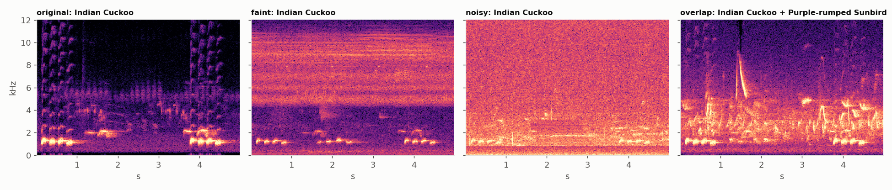
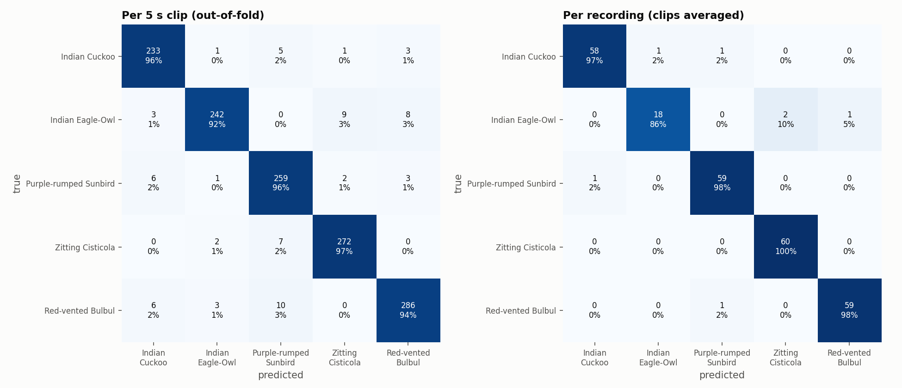
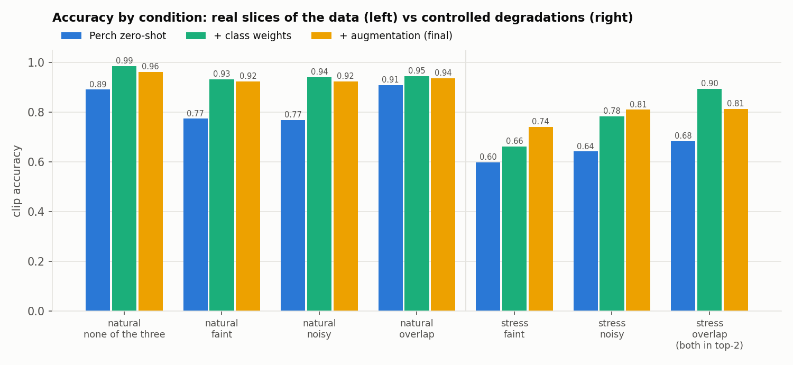
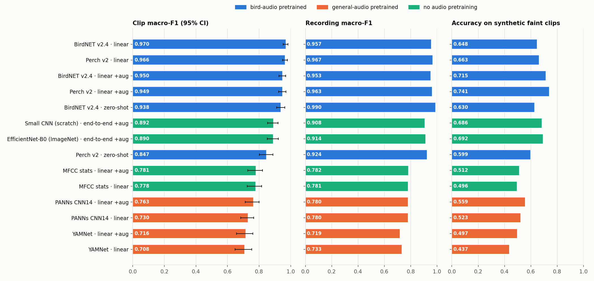
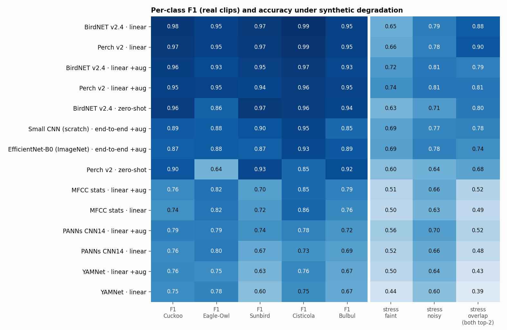
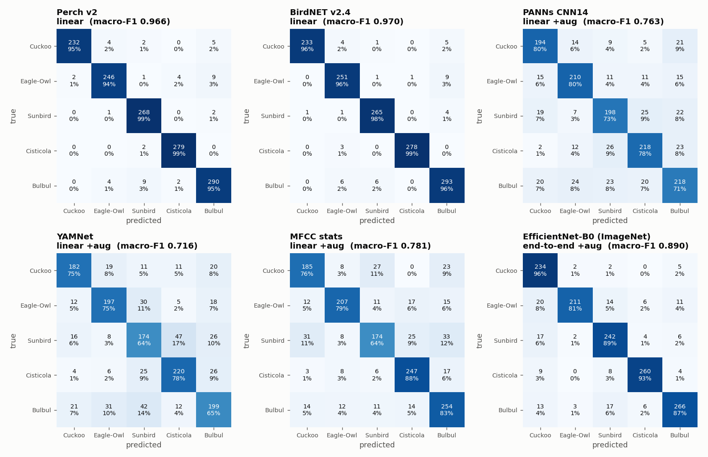

# Bird Call Classifier — write-up

**Result:** 5-species classifier on Google's Perch v2 embeddings. Out-of-fold **macro-F1 0.949 per 5 s clip,
0.963 per recording** (261 recordings, 1,362 clips, grouped 5-fold CV). Perch zero-shot on the same clips scores 0.847.
A comparison against BirdNET, PANNs, YAMNet, MFCC features and end-to-end CNNs is [below](#comparative-study-is-perch-the-right-choice).
The weakest class is the Indian Eagle-Owl (18/21 recordings correct).

## Data

261 xeno-canto recordings from 127 recordists in 36 countries. The full list with IDs and links is in [DATASET.md](DATASET.md).
I did **not** keep only the best recordings. The downloader draws round-robin across quality ratings A–E
(71/91/62/27/10) and across "other species listed / none", so poor recordings are included on purpose.

- **Faint** and **noisy** clips: every clip gets a band-energy level and an SNR estimate. The bottom quartile of each is tagged
  faint or noisy (≈340 clips each).
- **Overlap**: 96 recordings list other species calling in the background. That gives 475 clips.
- **Oriental Magpie-Robin could not be included.** xeno-canto marks it as a *restricted species* (it is trapped for the cage-bird trade).
  The API withholds the audio and location for all 851 of its recordings. The code has a drop-in folder for these files if access is granted.
  The results below are for 5 classes.
- **Imbalance:** there are only 21 Eagle-Owl recordings, compared with 60 per class (capped) for the others. 13 of the 21 come from one recordist.

## Approach and why

**Model: Perch v2 embeddings (1536-d) + a linear head.** Perch was trained on xeno-canto/iNat-scale bird audio, and its label set
already contains all six species. That gives two things: a zero-shot baseline for free, and embeddings in which species are
close to linearly separable. With about 1.3k clips, fine-tuning a CNN would mostly memorise recordists and sites.
A linear probe has 7.7k parameters and trains in seconds, so every experiment could be run under full cross-validation.

**What Perch already handles:** clean calls from well-recorded species, and a lot of robustness to noise. Its embeddings keep
91–95% accuracy on the real noisy, faint and overlapping slices of the data.
**What I had to solve:** (1) Perch's own classifier is badly calibrated for this set. Eagle-Owl recall is 47% zero-shot and Cisticola
absorbs the misses. The trained head fixes this (owl F1 0.64 → 0.95). (2) Weak labels: xeno-canto labels whole recordings, so the
code picks the highest-SNR 5 s windows per recording with an energy detector that does not use Perch. (3) Leakage-free
evaluation. (4) Imbalance, degraded audio, overlaps and abstention, described below.

## The messy parts (all in code)

| problem | what the code does | measured effect |
|---|---|---|
| imbalance | 16 windows per owl recording vs 8 for the others (`02`); class-balanced loss (`05`); extra augmented copies for minority classes (`03`) | Balancing at the window level already equalised clip counts, so class weights changed little (F1 0.965 → 0.966). The remaining gap is **diversity**: 21 owl recordings |
| faint | attenuate 14–26 dB, then add real background noise cut from the quietest windows of *other* recordings in the same fold | stress-faint accuracy 0.66 → **0.74** |
| noisy | real background noise, plus synthetic wind half the time, at 0–12 dB SNR | stress-noisy accuracy 0.78 → **0.81** |
| overlap | mix in a clip of a different species at −9 to 0 dB; the target is **multi-label** (sigmoid head), so both species are "correct" | did not help: both species in the top-2 0.90 → 0.81 (see below) |
| uncertain clips | confidence threshold chosen for 98% precision → "uncertain" below it | keeps 91% of clips at 98.1% accuracy (owl: 86% kept) |
| leakage | folds grouped by recording; noise and overlap partners are drawn only from the same fold | a stricter leave-*recordist*-out CV gives 0.960 vs 0.966, so leakage is small |

## Results

Clip-level F1: Cuckoo 0.949 · **Eagle-Owl 0.947** · Sunbird 0.938 · Cisticola 0.963 · Bulbul 0.945 (full report in
`results/classification_report.txt`).

**Where it struggles, stated plainly:**
- **Eagle-Owl** has the lowest recording-level recall (86%). All 3 misses (XC409708, XC663623, XC663630) are short, 30–55 s recordings,
  predicted as Cisticola or Bulbul. The owl hoots only a few times in a short file, but the code still takes up to 16 windows from it, so
  some of the "owl" windows probably contain no owl. I think this is a weak-label problem rather than a model problem, but I have not
  checked it by listening. With 21 recordings, 13 of them from one recordist, the owl numbers are fragile.
- **Bulbul → Sunbird** (10 clips) and **Cisticola → Sunbird** (7 clips) are the most common clip-level confusions. They are concentrated in
  5 and 3 recordings. The other 4 recording-level errors are two short Cuckoo files (3 s and 11 s), a quality-D Sunbird file and a Bulbul
  begging call recorded next to traffic.
- **Augmentation is a trade-off, not a free win.** It lowers F1 on real clips (0.966 → 0.949) and buys +8 pts on hard synthetic faint
  audio. The stress sets use the same generator as training, so that gain is optimistic. I kept augmentation in the final model
  because production audio is more degraded than curated xeno-canto uploads. `06_ablation.py` shows the alternative: noise-only
  augmentation keeps real-data F1 at 0.964.
- **Overlap-mixing augmentation did not help.** The frozen Perch embedding already keeps both species (0.90 have both in the top-2 without
  training on mixes). Adding mixed targets alongside faint/noisy copies lowered that to 0.81.
- The threshold and the augmentation weight were chosen on the same CV predictions they are reported on, which adds a small optimistic bias.

## Comparative study: is Perch the right choice?

I ran 14 variants on identical inputs: the same clips, the same recording-grouped 5 folds, the same augmented and stress audio (`03_augment.py`), and the same metrics.
The variants come from 7 feature sources × {zero-shot, linear head, linear head + augmentation, end-to-end}. Full table: `results/compare/comparison.md`.

| method | clip macro-F1 (95% CI\*) | recording macro-F1 | stress faint | trainable params |
|---|---|---|---|---|
| BirdNET v2.4 + linear | **0.970** (0.952–0.983) | 0.958 | 0.65 | 5.1k |
| Perch v2 + linear | 0.966 (0.948–0.979) | **0.967** | 0.66 | 7.7k |
| Perch v2 + linear + aug *(submitted model)* | 0.949 (0.924–0.970) | 0.963 | **0.74** | 7.7k |
| BirdNET v2.4 zero-shot | 0.938 (0.911–0.964) | 0.990 | 0.63 | 0 |
| Small CNN from scratch, end-to-end + aug | 0.892 (0.854–0.921) | 0.908 | 0.69 | 1.2M |
| EfficientNet-B0 (ImageNet), end-to-end + aug | 0.890 (0.852–0.922) | 0.914 | 0.69 | 4.0M |
| Perch v2 zero-shot | 0.847 (0.802–0.887) | 0.923 | 0.60 | 0 |
| MFCC statistics + linear + aug | 0.781 (0.728–0.821) | 0.782 | 0.51 | 0.8k |
| PANNs CNN14 (AudioSet) + linear + aug | 0.763 (0.713–0.800) | 0.780 | 0.56 | 10k |
| YAMNet (AudioSet) + linear + aug | 0.716 (0.657–0.760) | 0.719 | 0.50 | 5.1k |

\*bootstrap over recordings, not clips, because clips from one recording are correlated.

What the comparison shows:
- **Bird-specific pretraining is what matters.** Perch and BirdNET are statistically tied: their CIs overlap and each wins one of the two levels. Both are about 20 pts ahead of general-audio models.
  I kept Perch: it is best at the recording level, stays ahead on synthetic faint audio when augmented, and its 5 s window matches the clips. BirdNET is about 3× faster on CPU, so it is the better choice for edge deployment.
- **General-audio embeddings (PANNs, YAMNet) do worse than hand-crafted MFCCs.** AudioSet's classes stop at "Bird" / "Bird vocalization", so its embeddings encode *that* a bird is calling, not *which* one.
  This is not a head problem: tuned logistic regression on the same features gives the same scores (PANNs 0.76, YAMNet 0.70).
- **Training end-to-end** (1–4M parameters, SpecAugment, the same augmentation) reaches 0.89, clearly below a linear head on a bird embedding.
  ImageNet initialisation did not beat training from scratch. With only 261 recordings, the CNNs learn less than Perch/BirdNET learned from millions of labelled bird calls.
  They do beat the frozen bird models *without* augmentation on synthetic faint audio (0.69 vs 0.65–0.66), which again shows that the augmentation is doing the work there.
- **Zero-shot:** BirdNET's own classifier is far better calibrated for these species than Perch's (owl F1 0.86 vs 0.64). Its 0.990 recording-level F1 is the highest in the table.
  But both bird models were trained on xeno-canto, **so their zero-shot and embedding scores may include recordings they saw in training.** That inflates all the bird-model rows by an unknown amount; the fair test would be non-xeno-canto audio (future work 3).
- **The augmentation trade-off repeats for BirdNET:** −2 pts on real clips, +7 pts on synthetic faint audio, +2 pts on synthetic noisy audio. So the trade-off comes from the method, not from Perch.

Timing caveat: embedding speeds in `comparison.csv` were measured while other jobs shared the machine, so treat them as rough ratios only.

## With more time

1. **Get Magpie-Robin audio** by requesting restricted access from xeno-canto or using Macaulay Library, then retrain with 6 classes.
2. **Better window labels:** use xeno-canto's annotation sets or Perch detection scores to choose windows, or train with
   multiple-instance learning over all windows of a recording. This targets the owl failures directly.
3. **A real test set from production microphones.** Synthetic degradation cannot replace it, and the gap between the "natural" and "stress" bars shows why.
4. **Source separation** (Google's bird-MixIT) before embedding, for overlapping calls. Add an "other/none" class using
   soundscape negatives, so the model can say "not one of these six".
5. Per-class thresholds with temperature calibration, and more owl recordings from other sources to fix recordist concentration.
